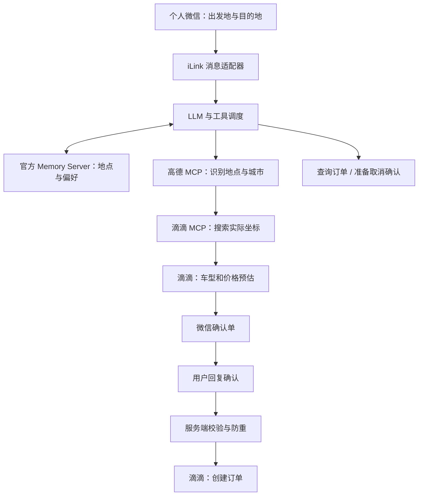

# WeChat DiDi Assistant

个人微信出行助手：通过通用 LLM 调用高德、滴滴和官方 Memory Server，实现地点解析、价格预估、明确确认后叫车、订单查询与长期记忆。

这是可自行部署的研究项目，与腾讯、滴滴、高德无隶属关系。默认使用滴滴沙箱；切换到生产环境会产生真实订单与费用，需要账号具备相应接口权限。

**部署入口：**[Windows / CMD 部署](WINDOWS.md) · [Linux 公网服务器部署](#linux-公网服务器部署)

## 项目成果

| 能力 | 已实现的行为 |
| --- | --- |
| 个人微信接入 | 根据腾讯公开 iLink 协议接收授权者的文本私聊，回复当前消息；支持消息去重 |
| 通用模型接口 | 支持 Chat Completions 和 Responses，模型地址、Key、模型名均可替换 |
| 省略城市 | 常用地点记忆优先；高德全国搜索识别城市，再由滴滴实时查询打车坐标；有歧义时选择地址 |
| 车型与价格 | 只展示车型名称、预估价，不展示品类代码和内部参数 |
| 确认后下单 | 确认单展示起点、终点、车型、价格；微信成功发出确认单后，回复“确认”才下单 |
| 订单管理 | 查询订单、司机信息、接口提供的预计抵达时间；取消订单需再次确认 |
| 防止重复动作 | 会话隔离、预估过期、确认单送达校验、单进程锁、事务消耗确认；结果不确定时不自动重试下单 |
| 长期记忆 | 官方 MCP Memory Server 保存/读取/修改/删除地点和偏好；重启保留，按用户隔离 |
| 本地管理 | 浏览器管理搜索设置与记忆，默认端口 `37691`；Key 不回显 |
| Linux 部署 | systemd 常驻、专用运行用户、外置配置与数据、SSH 管理通道 |
| Windows 部署 | CMD 安装和启动入口、用户独立配置/数据目录、可选登录后自动运行 |

**范围说明：**当前实现个人微信 ClawBot 文本私聊，尚未实现企业微信通道、群聊、语音、多用户 SaaS 或自动订单状态推送。订单与 ETA 查询由消息触发。微信协议依据腾讯公开源码整理，需使用自己的账号验证兼容性；“代码已实现”不等于第三方生产业务已验收。

## 工作原理



高德的坐标不会直接用于滴滴下单。记忆保存地址和偏好，不保存下单授权、实时价格或可用于下单的坐标。只说“去公司”仍会询问当前起点。

## 必需配置与申请链接

仓库仅提供 [`.env.example`](.env.example)，不包含已填写的 Key、微信凭证、聊天记录或个人记忆。

| 配置项 | 用途 / 是否必需 | 申请或配置文档 |
| --- | --- | --- |
| `LLM_API_KEY` | 必需：所选模型厂商的 API Key | 在所选厂商控制台创建；例如 [DeepSeek 控制台](https://platform.deepseek.com/) 与 [API 文档](https://api-docs.deepseek.com/) |
| `LLM_BASE_URL` | 必需：模型 API 基地址；代码会追加 `/chat/completions` 或 `/responses` | 所选厂商 API 文档；需要 `/v1` 的服务应保留该后缀 |
| `LLM_MODEL` | 必需：厂商实际提供、支持工具调用的模型 ID | 所选厂商模型列表；不能只根据“接口兼容”判断工具调用支持 |
| `LLM_API_MODE` | `chat` 或 `responses`，默认 `chat` | 按模型支持的接口选择；[DeepSeek 工具调用示例](https://api-docs.deepseek.com/guides/tool_calls/) |
| `DIDI_MCP_KEY` | 必需：滴滴个人 MCP Key；下单和取消需要对应权限 | [滴滴 MCP 控制台入口](https://mcp.didichuxing.com/) · [接入与工具文档](https://mcp.didichuxing.com/api) |
| `AMAP_API_KEY` | 全国地址/城市解析需要；若仅使用已保存城市或默认城市，可暂不填 | [高德创建 Key](https://developer.amap.com/api/mcp-server/create-project-and-key) · [官方 MCP 接入](https://developer.amap.com/api/mcp-server/gettingstarted)；服务平台选择 **Web服务** |
| 微信授权 | 无需自行填写微信 API Key；运行 `login`，本人扫码确认后保存授权凭证 | [腾讯微信插件说明](https://github.com/Tencent/openclaw-weixin/blob/main/README.zh_CN.md) · [公开协议](https://github.com/Tencent/openclaw-weixin/blob/main/docs/protocol_zh_CN.md) |
| Memory Server | 无需 API Key；`npm ci` 安装官方本地组件 | [官方 Memory Server](https://github.com/modelcontextprotocol/servers/tree/main/src/memory) |

其他配置：

| 配置项 | 默认值 / 说明 |
| --- | --- |
| `DIDI_ENV` | `sandbox`：模拟订单；`production`：确认后操作真实订单 |
| `DIDI_DEFAULT_CITY` | 可留空；无高德 Key 时作为搜索城市，有 Key 时作为高德搜索提示 |
| `ADMIN_PORT` | `37691`，也可用 `--ui-port` 覆盖；始终只绑定 `127.0.0.1` |
| `LLM_EXTRA_BODY` | 默认 `{}`，按模型厂商要求设置额外参数，不能覆盖工具和消息 |
| `WECHAT_CHANNEL_VERSION` | `2.4.10`，按实际腾讯协议更新调整 |
| `APP_ENV_FILE` | 进程环境变量，指定配置文件路径；默认项目目录 `.env` |
| `APP_RUNTIME_DIR` | 进程环境变量，指定持久数据目录；默认项目目录 `.runtime` |

`APP_ENV_FILE` / `APP_RUNTIME_DIR` 应在启动进程前设置，Linux 服务与辅助命令已设置好。系统环境变量优先于配置文件；管理界面保存的高德 Key / 默认城市优先于相应配置文件字段。界面留空 Key 表示保留，清除按钮会写入空值并覆盖环境中的 Key。旧滴图 `DIDI_MAP_KEY` 已停用。

## Linux 公网服务器部署

推荐 Ubuntu 24.04 / Debian 12、systemd、Python 3.11+、系统 PATH 中可用的 Node.js 22+ 与 npm。Python 程序使用标准库，不需要 pip 依赖。Node 仅运行固定版本的官方 Memory Server 和 MCP SDK。

服务器需要能通过 HTTPS 访问模型厂商、微信、滴滴、高德；安装时还需访问 GitHub 和 npm。服务主动长轮询微信，不需要域名、HTTP 回调或开放管理端口。

### 1. 准备环境并安装

先按 [Node.js 官方下载说明](https://nodejs.org/en/download) 安装 Node.js 22+。请确保普通系统用户也能执行 `node` 和 `npm`，不要只安装在 root 的 nvm 目录。

```bash
sudo apt update
sudo apt install -y python3 git ca-certificates
python3 --version
node --version
npm --version

git clone https://github.com/ZCravenQ/wechat-didi-assistant.git
cd wechat-didi-assistant
sudo bash deploy/install.sh
```

安装器创建专用用户 `wechat-didi`，安装固定 npm 依赖，并生成 systemd 服务；**不会自动启动微信或操作订单**。目录布局：

```text
/opt/wechat-didi-assistant/       程序和依赖
/etc/wechat-didi-assistant.env    Key 与配置，仅 root/服务账号可读
/var/lib/wechat-didi-assistant/   SQLite、微信授权、管理设置和长期记忆
/usr/local/bin/wechat-didi       以服务账号运行辅助命令
```

### 2. 填写配置并扫码授权

```bash
sudo nano /etc/wechat-didi-assistant.env
sudo wechat-didi memory-check
sudo wechat-didi tools
sudo wechat-didi login
```

配置文件使用 `NAME=value` 格式，值不要额外加引号。先填写模型、滴滴、高德配置并保留 `DIDI_ENV=sandbox`。`tools` 会实际连接滴滴并列出该 Key 的权限。

`login` 在终端输出腾讯返回的二维码内容或图片地址。用自己的微信完成扫码授权；如果终端无法显示，在自己的浏览器查看返回的二维码链接。不要公开该链接或登录日志。二维码格式或账号接入不兼容时按腾讯官方说明处理，本程序不会绕过登录条件。

### 3. 启动常驻服务

```bash
sudo systemctl enable --now wechat-didi
sudo systemctl status wechat-didi --no-pager
sudo journalctl -u wechat-didi -n 50 --no-pager
```

systemd 会在进程异常退出后重启；短时间连续失败会停止重试。修正配置后可执行 `sudo systemctl reset-failed wechat-didi`，再启动。修改配置文件后运行 `sudo systemctl restart wechat-didi`；界面修改高德 Key 下一次查询生效。

### 4. 从自己电脑打开管理界面

在自己电脑的终端（Windows CMD 也可以）运行，替换 SSH 用户与服务器地址：

```bash
ssh -N -L 37691:127.0.0.1:37691 用户名@服务器地址
```

保持窗口运行，在本机浏览器打开 **http://127.0.0.1:37691**。服务器安全组只需允许自己的 SSH 访问，无需开放 `37691`。界面没有公网多用户登录功能，不能直接反向代理到公网。

若本机 `37691` 已占用，可改成 `ssh -N -L 37693:127.0.0.1:37691 用户名@服务器地址`，然后访问本机 `37693`。若服务器端口冲突，修改配置中的 `ADMIN_PORT` 并同步调整映射目标。

### 5. 验证后切换真实出行

先在沙箱检查收消息、记忆、搜索、预估与确认流程。确认自己的滴滴 Key 提供下单/查询/取消权限后，将配置改为 `DIDI_ENV=production` 并重启。生产模式必须重新获得当前订单确认；环境切换不会复用旧确认单。

只运行一个实例；进行 `console` / `ui` 调试或重新登录前，先 `sudo systemctl stop wechat-didi`，结束后再启动。`ui` 模式可以在模型和滴滴尚未配置好时单独运行。

## 微信使用示例

```text
你：从望京 SOHO 到国贸，查一下价格。
助手：展示实际查询到的车型名称和预估价。

你：选快车叫车。
助手：
【真实叫车确认单】
出发地：望京 SOHO
目的地：国贸
车型：快车
预估价：以本次接口结果为准
回复“确认”下单。

你：确认
助手：只有滴滴接口明确成功，才回复订单已创建。
```

- “查询订单”“司机还有多久到？”会重新查单。接单后的 ETA 表示到上车点，行程中的 ETA 表示到目的地；接口未提供时不推算。
- “取消订单”先产生取消确认单，按卡片提示回复 `确认取消 确认码` 才取消。
- “记住，公司在杭州市，地址是……”“记住，车型偏好是优先快车”可保存记忆；地点保存需要明确城市和完整地址。
- “查看记忆”或 `/memory` 查看；“修改……”覆盖同名内容；“删除公司这个地点”删除。
- `/reset` 只清理当前聊天，不删除长期记忆，也不会清除待核实订单状态。

确认授权仅对当前会话当前确认单有效，本地有效期为 90 秒；实际滴滴预估可能更早失效。更改出行需求后应重新预估和确认。不要把生产下单用于无实际出行需求的测试。

## 更新、备份与恢复

更新前停止服务并备份，再在原始源码 checkout 中执行：

```bash
git pull --ff-only
sudo bash deploy/install.sh
sudo systemctl start wechat-didi
```

安装器保留已有配置和运行数据。**备份整个 `/var/lib/wechat-didi-assistant` 与 `/etc/wechat-didi-assistant.env`**，备份前先停止服务，确保 SQLite 和记忆文件一致；恢复时保留服务账号所有权与私有权限。备份包含个人信息和凭证，不要上传 GitHub。切勿用删除数据库的方式处理下单超时，先在滴滴 App 核对真实状态。

## 本地开发与测试

Python 3.11+、Node.js 22+，Windows/Linux 均可：

```bash
npm ci --ignore-scripts
# Linux/macOS 使用 cp；Windows CMD 使用 copy
cp .env.example .env
python -X utf8 main.py ui
```

其他模式：`console`、`tools`、`login`、`wechat`、`memory-check`。控制台记忆与微信记忆相互隔离。

```bash
python -X utf8 -m unittest -v test_agent test_admin_places test_amap test_memory_mcp test_deploy
python -X utf8 offline_demo.py
```

业务回归使用模拟微信、模型和地图/滴滴接口；官方记忆集成测试使用实际 Node 组件与临时文件。CI 在 Ubuntu 和 Windows 上执行回归及安装检查，不使用真实 Key；Windows 检查还覆盖更新保留配置、文件锁和私有目录权限，不实际注册自动启动任务。CI 通过不代表真实微信、高德和滴滴账号已经完成端到端验收。

## 数据与发布边界

- `.env`、`.runtime`、数据库、微信授权、记忆、日志和备份均在 `.gitignore` 中排除；示例配置仅包含空值或占位符。
- 长期记忆和对话会作为上下文交给所配置的模型；地点检索会发送到对应地图服务。
- 对外接口失败不输出凭证或完整带 Key 的 URL。管理界面仅回显 Key 是否配置，并校验 Host、Origin 与管理令牌。
- 程序是单用户串行原型；不保证消息恰好投递一次。发送结果不确定、进程中断时，已处理消息不会自动重放订单动作，需要人工核对。
- 不要在 Issue、截图或日志中提交真实 Key、手机号、登录二维码、精确住址或完整订单。

## 依赖与参考

- [Tencent/openclaw-weixin](https://github.com/Tencent/openclaw-weixin)：微信协议来源。
- [滴滴 MCP](https://mcp.didichuxing.com/api)：地点、预估、订单与行程工具。
- [高德 MCP](https://developer.amap.com/api/mcp-server/summary)：全国地点、详情与城市识别。
- [官方 MCP Memory Server](https://github.com/modelcontextprotocol/servers/tree/main/src/memory) 与 [TypeScript SDK](https://github.com/modelcontextprotocol/typescript-sdk)：本地长期记忆组件。

本仓库暂未指定开源许可证；第三方依赖遵循各自许可证，服务使用受对应平台规则约束。
